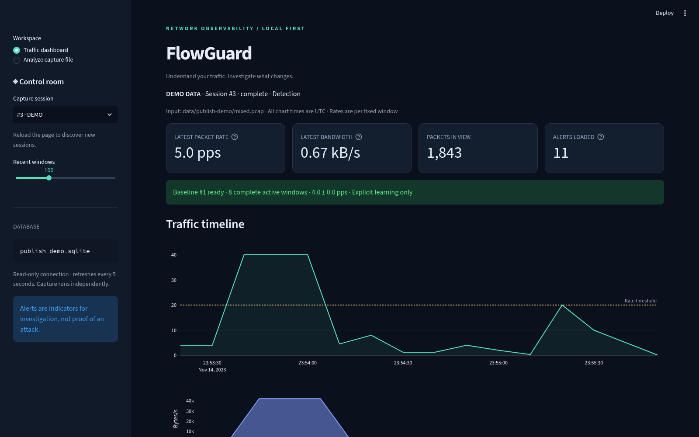
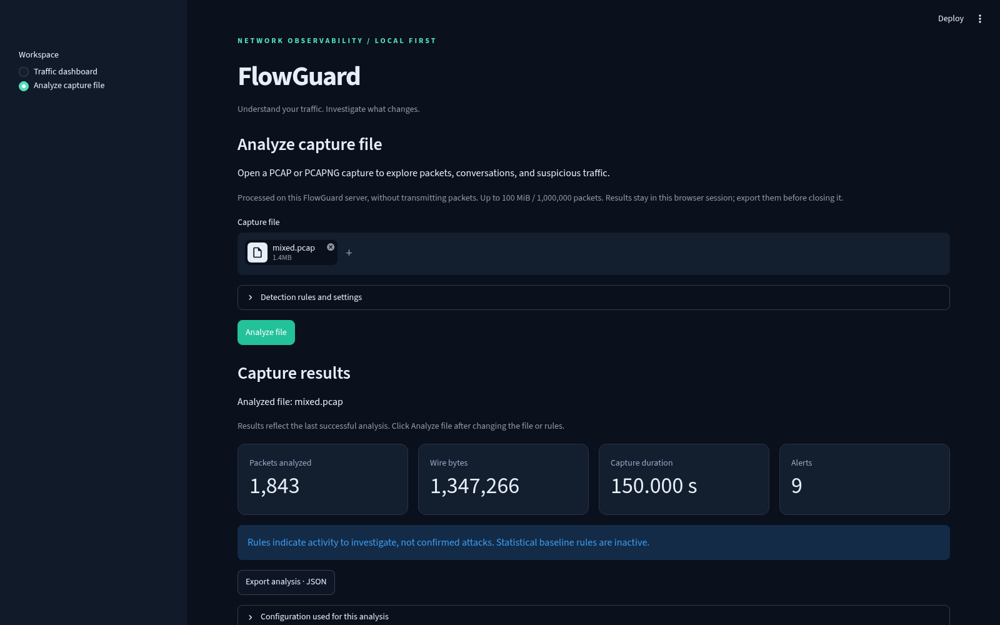

# FlowGuard

[](https://github.com/arwvah/FlowGuard/actions/workflows/ci.yml)

**Understand your traffic. Investigate what changes.**

FlowGuard is a Python/Scapy network anomaly detector with explicit statistical learning, explainable alerts, SQLite persistence, and a dark Streamlit/Plotly investigation dashboard. Capture, analysis, and the dashboard run independently. Alerts are indicators requiring investigation, never proof of an attack.

## Screenshots

Screenshots below show the running application using generated **synthetic demo traffic**, not a live network capture.





## Highlights

- **12 explainable detectors**: learned packet-rate and bandwidth anomalies, scans, SYN excess, unexpected protocols/ports, host sweeps, suspicious TCP flags, DNS bursts, long-query tunneling heuristics, ICMP echo floods, and TCP reset bursts.
- **Two investigation workflows**: persistent traffic sessions in SQLite and an interactive PCAP/PCAPNG upload workspace.
- **Evidence for each alert**: observed values, thresholds, severity, timestamps, and source metadata where available.
- **Reproducible offline lab**: generate normal and anomalous captures without transmitting packets.
- **Local operation**: Python analysis, a Streamlit/Plotly dashboard, CSV/JSON exports, and optional desktop launcher.

## Quick start

```bash
git clone https://github.com/arwvah/FlowGuard.git
cd FlowGuard
python3 -m venv .venv
source .venv/bin/activate
python -m pip install -e '.[dev]'
flowguard demo --output data/demo --db data/demo.sqlite
flowguard dashboard --db data/demo.sqlite
```

Open **http://127.0.0.1:8501**. The demo requires no capture privileges. For live capture, see the permissions and CLI sections below.

## Repository guide

| Path | Purpose |
| --- | --- |
| `src/flowguard/ingest.py`, `pcapng.py` | Packet ingestion and capture-file parsing |
| `metrics.py`, `baseline.py`, `detection.py` | Window aggregation, learned baselines, and anomaly rules |
| `service.py`, `storage.py` | Analysis lifecycle and SQLite persistence |
| `dashboard.py`, `file_dashboard.py`, `file_analysis.py` | Traffic dashboard and interactive file investigation |
| `demo.py`, `cli.py`, `desktop.py` | Offline fixtures, command-line interface, and desktop integration |
| `tests/` | Automated regression tests |
| `config.example.toml` | Supported thresholds, allowlists, and resource limits |

Validation on October 29, 2026: **132 tests passed**. The offline demo reported zero normal-traffic alerts and exercised all 12 detectors. This does not establish production detection accuracy.

## Omarchy desktop app

After installing dependencies, install the desktop launcher once:

```bash
flowguard install-desktop
```

Press **Super+Space**, search **FlowGuard**, and open it. No terminal or manually started server is needed. The app uses Omarchy's Chromium app-window convention: its own window without browser tabs, a FlowGuard icon, and a separate browser profile. Chromium must be installed (`omarchy pkg add chromium` if needed).

On first launch, FlowGuard creates an offline demo at `~/.local/share/flowguard/flowguard.sqlite`. Later launches reuse that database. Demo sessions remain clearly labeled. Each launch starts an unprivileged local dashboard on an available loopback port, waits for it to become ready, and opens the window. Closing the window stops that dashboard; any separately running capture process continues independently. Opening the same database twice shows an already-open notification rather than starting duplicate servers. The Chromium sandbox stays enabled.

```bash
# Launch from a terminal:
flowguard desktop
# Open your existing analysis or live-capture database in the desktop window:
flowguard desktop --db "$PWD/data/live.sqlite"
# Make the Omarchy menu entry open that live database by default:
flowguard install-desktop --db "$PWD/data/live.sqlite"
```

The app follows `XDG_DATA_HOME`, `XDG_CACHE_HOME`, and `XDG_STATE_HOME` when set to absolute paths. Defaults: data in `~/.local/share/flowguard/`, app profiles/locks in `~/.cache/flowguard/`, and current/previous launch logs in `~/.local/state/flowguard/desktop-*.log`. An explicitly supplied missing database is an error, so a typo cannot silently display demo data.

The installed launcher is `~/.local/bin/flowguard-desktop`; its menu entry is `~/.local/share/applications/FlowGuard.desktop`. It uses this project's virtual environment, so keep the project folder in place and rerun `flowguard install-desktop` after moving it. To remove just the menu entry, run `omarchy webapp remove FlowGuard`; this preserves your project and data.

Desktop integration uses the installed Omarchy webapp installer, Chromium's [isolated user-data directory](https://chromium.googlesource.com/chromium/src/+/main/docs/user_data_dir.md), and the [Desktop Entry specification](https://specifications.freedesktop.org/desktop-entry/latest/).

## Install

Python 3.11+ is required. From this project directory:

```bash
python3 -m venv .venv
source .venv/bin/activate
python -m pip install -e '.[dev]'
```

Or with uv (the development environment uses Python 3.13):

```bash
uv sync --extra dev
source .venv/bin/activate
```

Dependency installation requires network access unless packages are cached. Once installed, the demo, tests, and dashboard need no network service, credentials, capture permissions, or root access.

## Reproducible offline demo

```bash
flowguard demo --output data/demo --db data/demo.sqlite
flowguard dashboard --db data/demo.sqlite
```

Open **http://127.0.0.1:8501**. Select the latest DEMO session. The demo writes deterministic normal, spike, scan, SYN, unexpected-protocol/port, suspicious-traffic, and combined classic PCAP files. It learns eight complete normal windows, checks normal traffic produces zero alerts, and verifies the combined capture triggers all twelve detectors: `packet_rate`, `bandwidth`, `port_scan`, `syn_excess`, `unexpected_protocol`, `unexpected_port`, `host_sweep`, `suspicious_tcp_flags`, `dns_burst`, `dns_tunnel_heuristic`, `icmp_echo_flood`, and `tcp_reset_burst`. No packets are transmitted. Repeating the command creates new sessions and a new explicitly learned baseline; fixtures are overwritten deterministically.

Generate fixtures without analyzing them:

```bash
flowguard generate-demo --output data/fixtures
flowguard learn --pcap data/fixtures/normal.pcap --db data/lab.sqlite --name lab-normal
flowguard analyze --pcap data/fixtures/mixed.pcap --db data/lab.sqlite
flowguard dashboard --db data/lab.sqlite --port 8502
```

## Analyze capture files

Open FlowGuard and choose **Analyze capture file** in the sidebar. Upload a `.pcap`, `.pcapng`, or `.cap` file and click **Analyze file**. You can start this workspace without an existing database:

```bash
flowguard dashboard
```

The file workspace includes packet/byte totals, protocol counts, traffic timelines, directional conversations, and suspicious-traffic findings with reasons and thresholds. Filter packets by protocol, source/destination text, port, or SYN/RST flags, then inspect a packet's metadata. Select a finding to restrict the packet preview to its source and time window. Export the analysis as JSON or filtered packets/alerts as CSV.

All ten non-statistical traffic rules run without a baseline. Upload an optional TOML configuration under **Detection rules and settings** to tune thresholds and allowlists; `config.example.toml` lists the settings. The file workspace never trains on an uploaded capture or uses a live/demo database's baseline. The two learned rate/bandwidth rules are inactive here; use CLI analysis with a suitable baseline if needed.

Uploads are processed on the local FlowGuard server and held in the session; no packets are transmitted and no uploaded capture or report is written to SQLite. Results contain metadata, not payload bytes. Export results before closing/reloading the browser session. This provides packet investigation, not Wireshark's full protocol dissection, payload/hex view, or stream reassembly.

Interactive limits: **100 MiB and 1,000,000 packets**. All packets in a successful analysis are evaluated by the rules, even when previews are limited. The UI/JSON retains the first 10,000 packet metadata rows, latest 1,000 active windows and 5,000 alerts, and first 2,048 directional conversations (sorted by bytes). Whole-capture totals and detector counts remain available, and omitted conversation/source-tracking counts are reported. Packet filters and CSV exports apply to the retained preview. Files exceeding the processing limit fail explicitly; use the streaming CLI for larger captures:

```bash
flowguard analyze --file capture.pcapng --db data/file-analysis.sqlite --config config.example.toml
flowguard dashboard --db data/file-analysis.sqlite
```

`--file` and `--pcap` are aliases on `analyze`. CLI analysis persists aggregate results/alerts, not the interactive packet preview. It retains the existing latest-baseline selection behavior, so use a fresh database or an explicitly chosen `--baseline-id` for unrelated captures.

## CLI

```bash
flowguard --help
flowguard interfaces
flowguard learn --pcap normal.pcap --db data/flowguard.sqlite --config config.example.toml --name office
flowguard analyze --pcap capture.pcap --db data/flowguard.sqlite --config config.example.toml
# Pin a known baseline instead of using the latest one in this database:
flowguard analyze --pcap capture.pcap --db data/flowguard.sqlite --baseline-id 1
# Authorized local live capture (replace eth0 with an interface from `interfaces`):
flowguard learn --interface eth0 --seconds 120 --db data/live.sqlite
flowguard monitor --interface eth0 --seconds 300 --db data/live.sqlite
# Omit --seconds on monitor to continue until Ctrl+C or SIGTERM.
flowguard dashboard --db data/live.sqlite
```

Learning defaults to 120 seconds for a live interface. It saves a new immutable baseline only after the minimum complete active windows are available; failed learning preserves previous baselines. Learning deliberately does not detect anomalies, so choose a trusted normal period. Monitoring never updates a baseline. Without a baseline, rule detectors operate and the CLI/dashboard explicitly report that rate detectors are disabled. Use separate databases or `--baseline-id` for different interfaces, networks, or workloads; latest baseline selection does not infer whether captures describe the same network. The window duration and minimum sample count must match the selected baseline.

Classic PCAP (microsecond or nanosecond timestamps, either byte order) and PCAPNG 1.0 are supported; format is detected from file content. PCAPNG supports Enhanced and legacy Packet Blocks, multiple interfaces/sections, both byte orders, decimal/binary timestamp resolution, and signed timestamp offsets. Simple Packet Blocks lack timestamps and are rejected instead of inventing event times. Ancillary blocks are skipped; embedded decryption secrets are not used. Framing follows the [PCAPNG format specification](https://www.ietf.org/archive/id/draft-ietf-opsawg-pcapng-04.html).

Invalid/truncated records, unsupported packet link types, and out-of-order timestamps yield an error. CLI sessions are marked failed, with already committed complete windows inspectable; the interactive workspace discards failed reports. Sort out-of-order captures with Wireshark's `reordercap input.pcap input-sorted.pcap`. Classic capture snaplen and PCAPNG block sizes are limited to 16 MiB; PCAPNG allows up to 4,096 interfaces per section. Empty captures report that there are no packets.

## Linux capture permissions

Live Scapy capture needs raw socket access (normally `CAP_NET_RAW`, or root). Offline analysis and the dashboard require neither. List interfaces first, and capture only networks you are authorized to observe. The default dashboard listens on localhost.

For a short capture, elevate **only the capture CLI**, using the environment's executable and an absolute database path:

```bash
sudo .venv/bin/flowguard learn --interface eth0 --seconds 120 --db "$PWD/data/live.sqlite"
sudo .venv/bin/flowguard monitor --interface eth0 --seconds 300 --db "$PWD/data/live.sqlite"
# After stopping capture, give your user ownership if sudo created these files:
sudo chown -R "$(id -u):$(id -g)" data
flowguard dashboard --db data/live.sqlite
```

Do not run Streamlit as root or grant capabilities to a general-purpose Python executable. A dedicated capture service with narrowly scoped capabilities is another deployment option, beyond this portfolio project's scope. Depending on directory/file permissions, an unprivileged dashboard may need read access to the database and SQLite WAL/SHM files while capture runs. Keep them local and accessible only to intended users.

## Architecture

```text
PCAP / live socket → ingest.py → PacketMeta → metrics.py → Window
                                                        ├─ baseline.py (explicit learn)
                                                        └─ detection.py (monitor/analyze)
                                                             ↓
                                                         storage.py → SQLite WAL
                                                                         ↓
                                                    dashboard.py (read-only, 5s refresh)
cli.py → service.py coordinates the pipeline; demo.py writes local fixtures.
```

Ingestion decodes with Scapy and discards payloads after extracting timestamp, addresses, ports, protocol, wire size, TCP flags, ICMP type, and DNS query-name length. DNS names themselves are never retained. SQLite stores aggregate metadata, sessions/configuration, baselines, and alerts; it never stores packets or payloads. The locally generated demo PCAP files do contain synthetic payload bytes. The file workspace uses the same ingestion/aggregation/detection pipeline via `file_analysis.py`, with bounded metadata previews held in session memory and displayed by `file_dashboard.py`.

Each window records packet/byte rates, protocol distribution, destination-port counts, and bounded source counts. Offline processing is strictly event-time based and does not sleep to simulate replay. Windows align to epoch multiples of the configured duration. Entirely idle windows are omitted: gaps reset rate persistence, and learning models **active windows**, not average utilization over wall-clock time. There is no allocation or loop per second of an idle gap. First/last partial windows remain visible but are excluded from learning and sustained rate checks. Counts/rules may still alert in partial windows. Live capture flushes completed windows on a one-second heartbeat, even if traffic stops. SIGINT/SIGTERM flushes the partial window and closes the capture socket/database.

Live aggregation uses a local receipt clock derived from a wall-clock anchor plus monotonic elapsed time. This tolerates out-of-order kernel timestamps on Wi-Fi and prevents system-clock adjustments from moving windows backward. Offline analysis continues to use the timestamps recorded in the PCAP. Live rates therefore describe packets as processed; a capture backlog can delay or compress their apparent timing. The live heartbeat uses the same clock as packet aggregation.

Learning uses Welford's online mean and sample standard deviation, with constant memory. For each rate metric:

```text
threshold = max(configured minimum, baseline mean × spike_factor,
                baseline mean + z_score × baseline standard deviation)
```

Rates must strictly exceed their threshold in `persistence_windows` adjacent complete windows. Zero variance is handled by the factor and absolute floor, with no division by standard deviation. Scan detection counts distinct destination ports per source across destinations and alerts **above** `scan_ports`. SYN detection counts SYN without ACK per source and requires both `syn_min_packets` and `syn_ratio` of that source's TCP packets. Unexpected protocols/ports require `unexpected_min_packets`.

By default, `ignore_service_replies` excludes UDP packets and TCP packets with ACK from **port rules only** when their source port is in `allowed_ports`. This reduces alerts on likely HTTPS/DNS replies to temporary client ports; raw destination-port metrics still include them. Initial TCP SYNs remain eligible. This is a source-port heuristic, not verified connection tracking: traffic using an allowed source port can evade these port checks. Set `ignore_service_replies = false` for strict destination-port inspection.

### Suspicious-traffic rules

These rules operate without a baseline, aggregate separately for each source, and use the existing alert cooldown. Defaults assume 10-second windows; counts also apply to partial windows. Each new threshold can be set to `0` to disable its rule.

| Rule | Default trigger per source/window | Interpretation |
| --- | --- | --- |
| `host_sweep` | Initial TCP SYNs to at least 20 distinct destination IPs | Possible host discovery; repeated SYNs to one host count once. Busy clients and legitimate discovery can trigger it. |
| `suspicious_tcp_flags` | At least 3 packets with NULL, FIN-only, Xmas (FIN/PSH/URG without ACK), SYN+FIN, or SYN+RST flags | Possible probing or malformed traffic. Normal ACK, SYN/ACK, FIN/ACK, reset, and ECN SYN flags do not trigger this rule. |
| `dns_burst` | At least 200 UDP packets to destination port 53 | Excessive DNS-like traffic. This counts packets, not decoded queries, and does not identify tunneling or inspect domain names. Busy resolvers may legitimately trigger it. |
| `dns_tunnel_heuristic` | At least 5 decoded DNS queries with names at least 70 characters long | Possible tunneling or unusual generated names. FlowGuard retains only name lengths. CDNs, anti-abuse systems, and other legitimate software can use long names. |
| `icmp_echo_flood` | At least 100 ICMPv4/v6 echo requests | Possible ping flooding or active diagnostics; echo replies and other ICMP messages do not count. |
| `tcp_reset_burst` | At least 50 RST packets and at least 80% of that source's TCP traffic | Possible rejected connections, probing, or service failures. The source sends the resets; it is not necessarily the scanner. |

Tune `host_sweep_hosts`, `tcp_flags_min_packets`, `dns_burst_packets`, `dns_long_query_length`, `dns_long_query_packets`, `icmp_echo_packets`, `rst_min_packets`, and `rst_ratio` in `config.example.toml` for the capture location and workload. These six rules have medium severity; set their count threshold to zero to disable them (the long-query length and reset ratio must remain valid). The flag rules are local detection heuristics using the TCP control-bit definitions in [RFC 9293](https://www.rfc-editor.org/rfc/rfc9293.html), not proof that a sender is malicious. Encrypted DNS is not visible; the burst rule is UDP-only, while the long-query heuristic evaluates decoded DNS queries on UDP or TCP port 53.

Alerts record window-end timestamp, detector, severity, observed count/rate, threshold, baseline mean when applicable, reason, and source when applicable. Destination is null for rules aggregating across destinations. Cooldowns are keyed by detector/source or detector/unexpected protocol or port, use event time, and reset per session. After cooldown, a continuing condition can alert again. Rule severities: rate/bandwidth/SYN high; scan/allowlist medium; tracking-cap warning low.

## Configuration and bounds

`config.example.toml` contains every supported setting. Unknown keys, invalid types, nonfinite values, invalid ports, and inconsistent limits are rejected. Empty `allowed_ports` or `allowed_protocols` disables that rule. Protocol names are case-sensitive; unknown IP protocols use names such as `IP-47` (GRE).

At most one active window, `max_sources` source records, `max_ports_per_source` ports per source, `max_hosts_per_source` SYN destinations per source (default 256), and `max_cooldown_keys` cooldowns are held by the detector. Global destination ports are bounded by the 65,536-port namespace. When source capacity is exceeded, global metrics still include every packet, but per-source detections have reduced coverage and emit `tracking_limit`. Per-source port and host counts become lower bounds at their caps; host-sweep thresholds cannot exceed the host cap. Evicting cooldown keys can allow earlier repeated alerts under high cardinality. The CLI retains no packet list; the file workspace retains only its bounded metadata preview plus the uploaded file in session memory.

SQLite retains at most `max_records` rows each for metrics and alerts globally, deleting the oldest transactionally. Old session summaries and baselines remain for audit/reuse, so disk size is not absolutely capped. SQLite reuses freed pages; retention does not shrink the file immediately. Archive databases as needed. Dashboard reads at most 1,000 windows, 5,000 alerts, and 200 session options; its filters and CSV export apply to the loaded alert subset, not an unbounded historical export. Charts and exported times are UTC. Mode labels distinguish DEMO, OFFLINE, and LIVE independently of learning/detection status.

## Verification

```bash
pytest -q
ruff check src tests
flowguard demo --output data/demo --db data/demo.sqlite
```

Tests cover false positives, all demo detectors, DNS length-only privacy, persistence, cooldown expiry/isolation, idle gaps, baseline sample requirements and zero variance, payload-free metadata, IPv4/IPv6/ARP/ICMP, event-time repeatability, malformed PCAP/PCAPNG/configuration, PCAPNG byte orders/sections/interfaces/timestamps, bounded previews with full-capture detection, database retention, packet filters, and the Streamlit upload/error workflow. CI runs lint/format checks and the suite on Python 3.11 and 3.13. Live capture needs an appropriate interface and permissions; offline tests do not exercise a privileged socket.

## Limitations

- Visibility is limited to traffic your interface receives. Switched networks, containers, VPNs, routing, offload, and capture placement change what is visible. This is not whole-network coverage.
- Encryption hides application content. FlowGuard analyzes observable metadata, not TLS content, exploit signatures, identities, or intent.
- Backups, deployments, health checks, and legitimate scanners can trigger alerts. Baselines are workload-specific; fixed thresholds and fixed windows can miss slow scans or patterns split across boundaries.
- SYN retransmissions/connection bursts are not proof of flooding. No flow reassembly, request/response correlation, fragmentation reassembly, distributed scan detection, or adaptive learning is performed.
- Scapy/Python and synchronous SQLite writes are suitable for a lab and moderate traffic, not a high-rate production IDS. Kernel drops can occur and are not measured. Hardware/offload behavior can distort observed packet sizes/counts.
- Unknown/non-IP frames are handled as metadata with limited address/protocol detail. IPv6 extension headers are traversed for transport extraction; tunnels are not recursively classified.
- SIGKILL or a machine crash can leave a session marked running and lose its uncommitted window. Restart creates a new session; cooldown and persistence state do not span processes.

References: [Scapy capture documentation](https://scapy.readthedocs.io/en/stable/usage.html) and [Streamlit periodic fragments](https://docs.streamlit.io/develop/api-reference/execution-flow/st.fragment).
